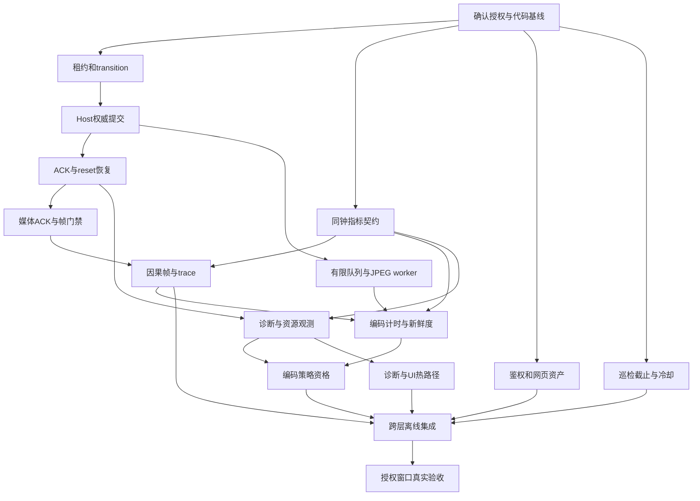

# 稳定性与端到端延迟整改 Implementation Plan

> **For agentic workers:** REQUIRED SUB-SKILL: Use superpowers:subagent-driven-development (recommended) or superpowers:executing-plans to implement this plan task-by-task. Steps use checkbox (`- [ ]`) syntax for tracking.

**Goal:** 在保留现有网络模式和控制协议的前提下，消除可复现的失控/恢复缺口与无界积压，建立可信延迟测量和可解释的网页故障恢复。

**Architecture:** 保留现有状态机，统一控制权异步提交和度量契约；控制、媒体、网页各自分任务验收。总plan只定义依赖、跨模块合约及集成验收；实际代码、文件和红绿测试步骤在三个子plan中，执行时必须同时读取总spec、总plan和对应子文档。

**Tech Stack:** Vanilla JavaScript、Node.js/Socket.IO、Python asyncio/aiortc/MSS/Quartz、现有Shell与Python巡检工具；node:test、unittest和既有受控场景工具。

**Spec:** [总spec](../specs/2026-10-17-reliability-latency-remediation-design.md)。事实基线为[72小时复查](../reports/2026-10-17-three-day-review-and-solution.md)。

## Global Constraints

1. 本轮仅诊断和文档；业务代码、运行配置、服务、tunnel 均不修改或重启。
2. 后续实施沿用严格单桌面 Viewer、控制租约和 fail-closed reset 屏障；不重放投递结果不确定的点击、文本或命令。
3. 不自动切换网络模式、TURN 节点或公网地址；保留 Quality Lock，不自动降低用户选择的分辨率。
4. 生产 Viewer 验收必须有明确维护窗口；普通检查不得创建会抢占用户控制的 Viewer。
5. 默认不增加运行依赖；纯函数、fake-clock 和模拟适配器测试不得启动真实抓屏、输入或公网连接。
6. 缺测使用 null/unavailable；不以 RTT/2、跨机 wall clock、frame_timing 到达或ACK冒充实际单向传输或可见效果。
7. 日志不保存键码、文本、剪贴板、坐标、token、完整URL或原始输入ID；仅保存有界关联摘要、状态和阶段耗时。
8. 不运行会重建生产dist的 npm test/pretest；定向使用 node --test、unittest 或已有独立临时构建入口。
9. 未做的真实公网、设备、光学或长时间验收必须标为 NOT RUN，不以单元测试通过替代。
10. 每个任务只提交该任务的文件或明确选择的改动，不夹带任务开始前的无关修改。

当前状态：**仅规划完成，以下实施复选框全部未执行**。用户确认默认使用superpowers规划，不等于授权本次实施、部署或tunnel操作。后续实施授权到达后从I0开始，不再询问规划路径。

## 文件结构与任务所有权

| 子项目 | Spec / Plan | 主要文件职责 |
|---|---|---|
| C：控制恢复 | [spec](../specs/2026-10-17-control-recovery-design.md) / [plan](2026-10-17-control-recovery-plan.md) | Signal租约/迁移；Host权威快照；Viewer输入恢复与媒体门禁 |
| M：媒体及延迟 | [spec](../specs/2026-10-17-media-latency-design.md) / [plan](2026-10-17-media-latency-plan.md) | latency-monitor唯一统计源；Host媒体worker/输入队列/帧关联；编码策略资格 |
| W：网页及观测 | [spec](../specs/2026-10-17-web-entry-observability-design.md) / [plan](2026-10-17-web-entry-observability-plan.md) | auth与资产状态；watcher预算；统一诊断持久化；前端热路径 |

共享业务文件 `python-host/host.py`、`web-client/js/input.js`、`web-client/js/webrtc.js`、`signal-server/websocket/signaling.js`禁止多任务同时写入。新模块边界和精确测试路径以子plan为准；不为本轮顺手拆解全部大文件。

## 依赖与集成顺序

箭头是契约/适配依赖。纯fixture可并行，涉及共享文件的适配串行。M5可以独立提交测量/资格结果；真实条件不足时保持现有资格并明确NOT RUN，不能为了把任务勾完直接放开档位。

### I0：保留现场与确定实施基线（后续实施第一步）

**Files:** 读取 `AGENTS.md`、`README.md`、`docs/runbook-safe-startup.md`及四份spec；新建 `docs/superpowers/reports/2026-10-17-remediation-execution.md`记录实施证据。

**Interfaces:** 消费用户实施授权和当前工作区；产出审查基线（commit、dirty路径、源码哈希、未授权运行项）。执行报告正文必须记录实际执行日期，不预填测试结果。

- [ ] 读取用户新指令，区分代码实施、部署与生产Viewer授权；没有实施授权则保持文档交付状态，不执行后续代码步骤。
- [ ] 运行 `git status --short`、`git diff --stat`、`git rev-parse HEAD`，逐项核对已有改动。当前已有控制修复未提交；不得通过reset/checkout清理它们。
- [ ] 按当前checkout读取子plan列出的文件；行号仅是审计定位，实施以函数和最新代码为准。只在需要隔离且不遗漏现有修复时使用worktree，记录基线差异。
- [ ] 建立执行报告：每任务包含实现commit、测试命令/结果、剩余风险、真实运行状态。初始化所有运行项为NOT RUN。

### I1：跨层离线合约与回归集成

**Files:** 消费三个子plan的测试文件；修改执行报告及 `docs/需求文档/WebRemoteDesktop-需求文档.md`的整改状态。必要跨层用例归入既有 `web-client/js/input-signaling-continuity.test.js`、`python-host/test_viewer_session_rebind.py`、`signal-server/websocket/signaling.test.js`，不另建第二套生产控制器。

**Interfaces:** C2 `_capture_authority()` / `_authority_matches(snapshot)`；M3 `reset_after_quiescent(old_scope, apply_reset)`；M1 `LatencyMonitor.snapshot({nowMs, scope})`；W3 `buildRuntimeDiagnostic({reason})`。详细入参及失败语义以子spec为准，版本不一致必须先改调用方与测试再合入。

- [ ] 逐任务执行子plan中红→绿→review→独立提交步骤。回归必须通过真实模块的行为调用；不能以检查源代码字符串存在作为竞态、截止时间或性能回归证据。
- [ ] 对照下表确认既有fixture覆盖所有跨层组合；缺项先在所属子任务补红测，不进入生产验收。

| 组合 | 必须断言的结果 | 责任 |
|---|---|---|
| rebind在租约将到期时成功，旧ACK随后到达 | 租约刷新、立即心跳；旧ACK不能确认新reset | C1/C3 |
| old offer或media await返回时，已有新grant/attempt | 新权威不回退；只清理旧对象 | C2/C4 |
| 普通键盘ACK丢失＋Socket短断＋reset超时 | 冻结输入，确认reset后至多一次自动acquire；不重放原输入 | C3 |
| Host队列已满＋有原生任务进行中＋lease更换 | 有界存储，旧待办不执行；in-flight完成/隔离前不确认reset | C2/M3 |
| 新输入应用时复用旧截图，trace晚700ms | 不虚构新鲜帧；晚元数据使用原rVFC时刻 | M2/M4 |
| 15分钟20FPS，元数据丢失/乱序/重复 | 内存有界、scope不串、正常淘汰不永久UNALIGNED | M2 |
| 暂停五分钟后恢复，旧ACK/旧frame晚到 | 不报300000ms渲染成本；必须同scope的新ACK和帧 | C4/M1/M2 |
| 自动上报时指标过期、缺测、同Viewer多份报告 | 自动/手动同schema；null保留；最新记录留存并记录淘汰 | M1/W3 |
| 503/代理403、登录悬挂、部署后旧资产、CSS失败 | 暂时故障保留凭据、请求截止、刷新/重试有界、ready完整 | W1 |
| 慢HTTP和子命令，动作超过冷却旧时间点 | 真正总deadline、完成后冷却、独立探测不空白 | W2 |

- [ ] 按子plan的定向命令重跑受影响测试；集成阶段仅扩大到共享文件调用者。使用 `node --test`直接运行明确文件，不运行npm pretest，不改变生产dist。Python测试用子plan指定环境和mock，禁止真实Quartz事件。
- [ ] 检查每条新诊断从生产者到服务端redactor再到磁盘的允许字段；构造含敏感输入的fixture，断言内容、坐标、token和完整URL均未落盘。确认schemaVersion=3的null/计数/窗口在自动和手动路径一致。
- [ ] 复查所有共享接口签名、authority revision递增时机和scope变化取消规则。尤其不能用媒体generation改变直接淘汰合法控制输入，不能让M/W观测逻辑直接授予控制。
- [ ] 更新执行报告，列出实际通过的命令与未运行项；仅提交自己新改动。需求状态只有对应验收通过才可标记完成，不把纯单元覆盖改写为公网通过。

### I2：授权维护窗口的实际性能与稳定性验收

**Files:** 阅读既有 `scripts/turn_controlled_scene.py`、`scripts/turn_controlled_scene_runtime.py`、`scripts/turn_controlled_scene_lab_runner.py`及其测试；结果归入实施日期的执行报告和脱敏evidence。使用受控内容与原生输入guard，不用独立overlay冒充实际应用响应。

**Interfaces:** 输入采用真实授权控制路径；输出同一事件的 `inputAckRttMs`、`inputToPostApplyFrameMs`、`inputToVisibleEffectMs`及失败分类。只有完整内容因果链才产出visible-effect；普通生产样本缺该链时为null。真实设备/入口配置从当次授权环境读取，禁止把账号、密码、域名写入计划。

- [ ] 在运行前检查明确维护窗口及现有Viewer占用；没有授权或有用户会话时该阶段保持NOT RUN。代码验证通过本身不触发重启或新Viewer。
- [ ] 记录浏览器/Host/Signal构建身份，路径（直连、明确选择的TURN、JPEG tunnel分别），分辨率/FPS、codec/bitrate、采样间隔、机器压力、输入类别和scope。既有工具的运行参数按其当前help与runbook核对，不直接照旧报告执行服务脚本。
- [ ] 先做正常资源和可控慢worker的短时受控场景。检查输入丢失/重复/乱序/未确认分母、复用帧年龄、队列峰值与超时；有不确定输入时不自动重放。
- [ ] 在原目标场景验证：core interactive P95≤5秒、点击连接到信令P95≤3秒、点击连接到稳定非黑画面P95≤8秒；指定TURN场景Host lag P95≤50ms、输入ACK P95≤150ms；720p/1080p编码P95≤25/45ms。报告完整采样分布，不能用阈值告警样本构造P95。
- [ ] 受控720p/20FPS记录真实inputToVisibleEffect及输入到rVFC的边界，检验历史150–200ms愿景；未达标记录事实，不能通过重命名ACK指标“通过”。如需要物理显示器延迟，另做光学测量，当前rVFC结果单独列示。
- [ ] 短测通过后每条待支持路径独立运行至少3小时，覆盖空闲、主动暂停/恢复、背景页、网络短断、滚轮突发、键盘组合/松键、切换质量档位、旧页面资产。保留周期摘要和异常，不把不同负载/路径混成一个分位数。
- [ ] 发布/回滚仅限另行授权的本地服务范围并遵守runbook；tunnel重建必须有直接授权。若故障复现，回退对应业务变更并保存证据，不以重启后暂时恢复判定修复成功。
- [ ] 按路径判定PASS/FAIL/NOT RUN，记录持续时间、有效样本、失败分母、版本和环境；文档同步实际结果。没有3小时数据或真实设备验证时保持剩余项未完成。

## 完整问题覆盖矩阵

| 诊断ID | 任务 | 关键验收 |
|---|---|---|
| R1、R5 | C1 | rebind续期/立即心跳；新transition新epoch、迟到ACK拒绝 |
| R2、R8、R9 | C2 | await后CAS；peer owner一致；旧media完成不覆盖新attempt |
| R3、R4、R6、R7 | C3 | 普通键盘ACK监督；reset失败后安全有界自动申请；不复用坏屏障 |
| R10、R11 | C4 | ACK/新帧同scope；legacy relay同pending门禁 |
| N1、D4、D5 | W3、I2 | 当前RSS/换页差分/完整lag分布；资源压力分场景 |
| N2、N4（P1） | M3 | 独立JPEG worker；可靠队列项数/字节数上限与安全reset |
| N3 | M5 | codec/FPS/码率同条件资格与Quality Lock |
| N5、N6 | W2、I2 | 真正deadline/完成冷却/独立分层采样 |
| N7、N8、N9、N10 | W1 | 暂时故障保留认证、资产版本兼容、CSS依赖及请求截止 |
| N11、N12 | W4 | ACK按原动作采样、增量预算；稳定帧不重复UI写入 |
| N13、L12 | M4 | fresh/reuse快照、实际generator消费计时、无重复加总 |
| D1、D2、D3、D6、L9、G1 | W3 | 长会话相对时间、disconnect原因、build/事件时间、统一快照及最新留存 |
| L1、L3、L4、L6、L7、L10 | M1 | 正确命名、同钟阶段、null、去重/超时/窗口/scope及sync生命周期 |
| L2、L5、L8、L11 | M2 | applied后新捕获、原rVFC时间、有界长trace、RTP成功边界 |

## 当前review与交付状态

本轮只完成文档与证据复查。所有子任务代码步骤、I0–I2运行步骤未勾选。审查记录见[文档review](../reports/2026-10-17-remediation-document-review.md)，并以总spec作为共同契约，后续任何接口变更应同步四份spec及调用方plan。
